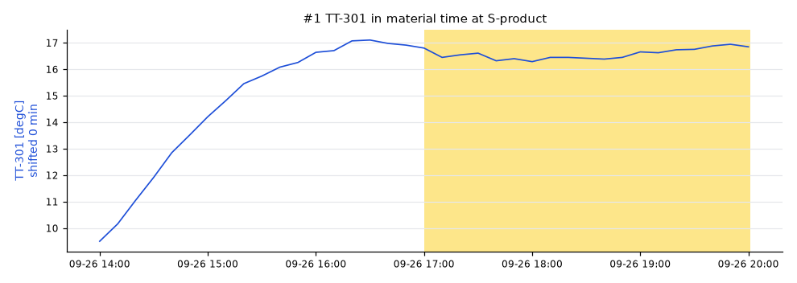
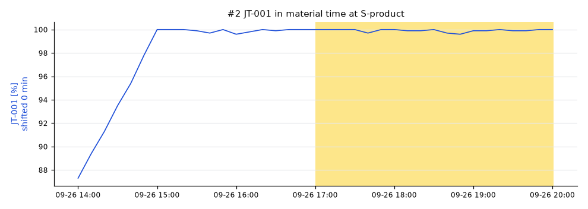
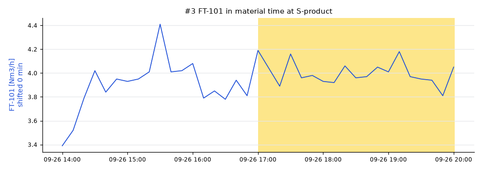
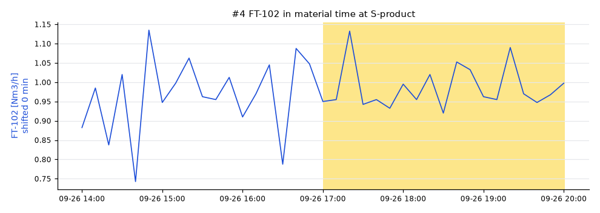

# Lot S20260926T2000: AT-202 high

AT-202 was **-71.5 degC** (spec high -72), sampled at SP-product on 2026-09-26 20:00 UTC.

penguineer 0.4.0, run 20261019T003812Z-350dc0.

## Summary

The leading hypothesis, with medium confidence: TT-301 moved high.

- `TT-301` (medium): TT-301 (E-301) ran 10.6 degC high from 2026-09-26 17:00, 0 min upstream of the sample point. [E002]
- `JT-001` (medium): JT-001 (EL-101) ran 24.9 % high from 2026-09-26 17:00, 0 min upstream of the sample point. [E003]
- `FT-101` (medium): FT-101 (S-H2) ran 1.01 Nm3/h high from 2026-09-26 17:00, 0 min upstream of the sample point. [E004]
_Summary from the template._

## Hypotheses

| # | Cause | Kind | Score | Confidence | Summary |
|---|---|---|---|---|---|
| 1 | `TT-301` | process | 0.35 | medium | TT-301 (E-301) ran 10.6 degC high from 2026-09-26 17:00, 0 min upstream of the sample point. |
| 2 | `JT-001` | process | 0.30 | medium | JT-001 (EL-101) ran 24.9 % high from 2026-09-26 17:00, 0 min upstream of the sample point. |
| 3 | `FT-101` | process | 0.28 | medium | FT-101 (S-H2) ran 1.01 Nm3/h high from 2026-09-26 17:00, 0 min upstream of the sample point. |
| 4 | `FT-102` | process | 0.27 | medium | FT-102 (S-CO2) ran 0.243 Nm3/h high from 2026-09-26 17:00, 0 min upstream of the sample point. |
| 5 | `D-401` | unmeasured disturbance | 0.20 | low | no measured tag upstream moved enough to explain AT-202; something unmeasured changed in D-401 or just before the sample (a catalyst, a fouled surface, a feed component nobody analyzes) |

### #1 TT-301

Path: E-301 → D-401 → S-product, dead time 0 min.

- effect size: 0.04, median moved 10.6 (+2.2 reference scales)
- onset: not run, no quality onset
- lag correlation: 0.86, r = +0.86 over 12 earlier lab results

### #2 JT-001

Path: EL-101 → S-H2 → S-feed → R-201 → V-301 → E-301 → D-401 → S-product, dead time 0 min.

- effect size: 0.01, median moved 24.9 (+2.0 reference scales)
- onset: not run, no quality onset
- lag correlation: 0.78, r = +0.78 over 12 earlier lab results

### #3 FT-101

Path: S-H2 → S-feed → R-201 → V-301 → E-301 → D-401 → S-product, dead time 0 min.

- effect size: 0.01, median moved 1.01 (+2.0 reference scales)
- onset: not run, no quality onset
- lag correlation: 0.72, r = +0.72 over 12 earlier lab results

### #4 FT-102

Path: S-CO2 → S-feed → R-201 → V-301 → E-301 → D-401 → S-product, dead time 0 min.

- effect size: 0.01, median moved 0.243 (+2.0 reference scales)
- onset: not run, no quality onset
- lag correlation: 0.70, r = +0.70 over 12 earlier lab results

### #5 D-401

Path: D-401 → S-product, dead time 0 min.

## Ruled out

- `TT-201`: did not move in the lot
- `TT-200`: did not move in the lot

## How this was worked out

- Lot window: 2026-09-26 17:00 to 2026-09-26 20:01 at S-product
- Quality onset: unknown
- Regime: DRY.bypass = 0, FFC-102.ratio = 0.25, FIC-101.mode = 2, FIC-102.mode = 2, H2.rate = 4, TIC-201.mode = 1, TIC-201.sp = 340
- Reference lots: S20260926T1100 (-76.5), S20260926T0800 (-78), S20260926T0500 (-80)
- Candidates tested: 6 tags on a 600 s grid
- Confidence: Confidence: high when the score is at least 0.4 and 0.025 ahead of the next hypothesis, medium from 0.25. Test weights: effect size 0.5, onset 0.3, lag correlation 0.3. Weights fitted on the homeostat train split (85 scenarios), thresholds chosen on the homeostat validation split (85 scenarios) (homeostat 0.1.0a3, bench plant 4144102c25e7).
- Note: some flows_to edges have no dead time; they count as 0 min
- Note: no online analyzer on the sampled stream: onset and correlation tests skipped
