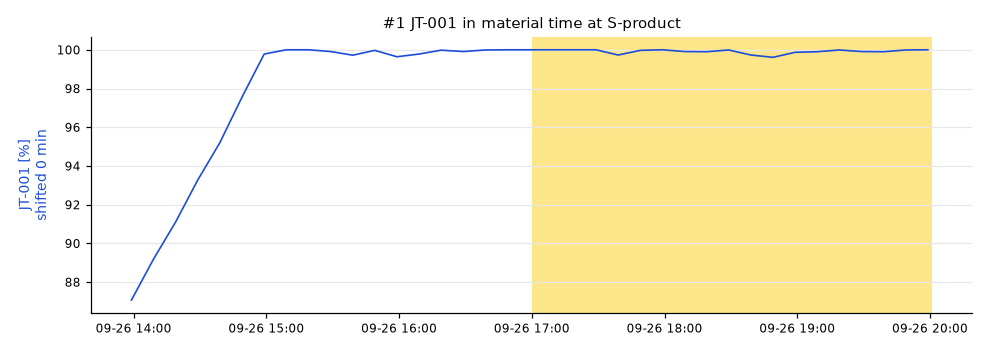
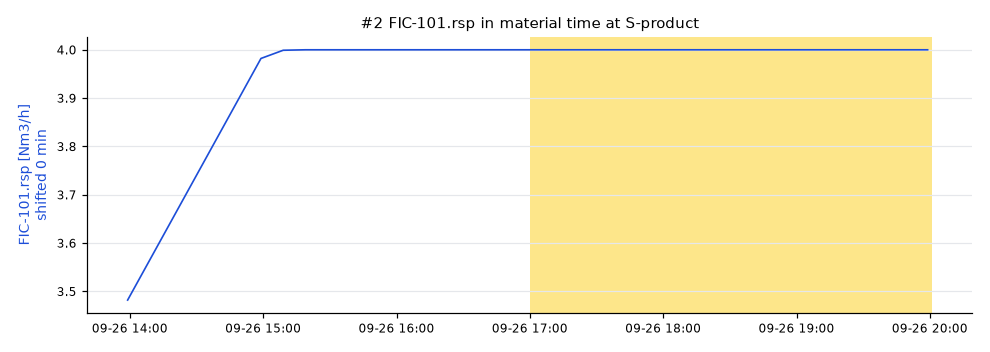
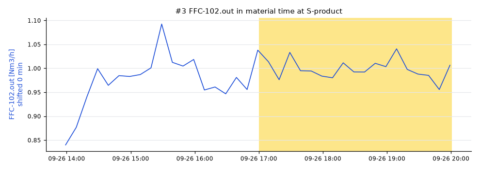
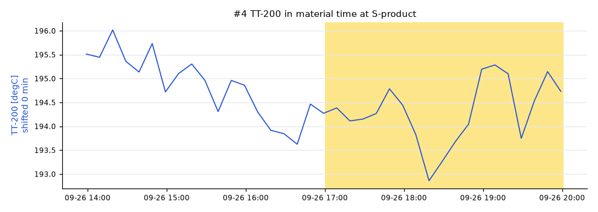

# Lot S20260926T2000: AT-202 high

AT-202 was **-71.5 degC** (spec high -72), sampled at SP-product on 2026-09-26 20:00 UTC.

penguineer 0.5.0, run 20261031T120233Z-d5d1d1.

## Summary

The leading hypothesis, with medium confidence: JT-001 moved high.

- `JT-001` (medium): JT-001 (EL-101) ran 24.9 % high from 2026-09-26 17:00, 0 min upstream of the sample point. [E004]
- `FIC-101.rsp` (medium): The setpoint FIC-101.rsp (loop:FIC-101) was changed 1 Nm3/h high from 2026-09-26 17:00, 0 min upstream of the sample point. [E005]
- `FFC-102.out` (medium): The setpoint FFC-102.out (loop:FIC-102) was changed 0.251 Nm3/h high from 2026-09-26 17:00, 0 min upstream of the sample point. [E006]
_Summary from the template._

## Hypotheses

| # | Cause | Kind | Score | Confidence | Summary |
|---|---|---|---|---|---|
| 1 | `JT-001` | process | 1.00 | medium | JT-001 (EL-101) ran 24.9 % high from 2026-09-26 17:00, 0 min upstream of the sample point. |
| 2 | `FIC-101.rsp` | setpoint change | 1.00 | medium | The setpoint FIC-101.rsp (loop:FIC-101) was changed 1 Nm3/h high from 2026-09-26 17:00, 0 min upstream of the sample point. |
| 3 | `FFC-102.out` | setpoint change | 1.00 | medium | The setpoint FFC-102.out (loop:FIC-102) was changed 0.251 Nm3/h high from 2026-09-26 17:00, 0 min upstream of the sample point. |
| 4 | `TT-200` | process | 0.28 | medium | TT-200 (S-feed) ran 4.87 degC low from 2026-09-26 17:00, 0 min upstream of the sample point. |

### #1 JT-001

Path: EL-101 → S-H2 → S-feed → R-201 → V-301 → E-301 → D-401 → S-product, dead time 0 min.

- effect size: 1.00, median moved 24.9 (+110.7 reference scales)
- onset: not run, no quality onset
- lag correlation: not run, not run
- explains away `FT-101`: its shift of 1 is 121% predicted from JT-001 (regression on the reference lots)

### #2 FIC-101.rsp

Path: S-H2 → S-feed → R-201 → V-301 → E-301 → D-401 → S-product, dead time 0 min.

- effect size: 1.00, median moved 1 (+333333333.3 reference scales)
- onset: not run, no quality onset
- lag correlation: not run, not run

### #3 FFC-102.out

Path: S-CO2 → S-feed → R-201 → V-301 → E-301 → D-401 → S-product, dead time 0 min.

- effect size: 1.00, median moved 0.251 (+11.6 reference scales)
- onset: not run, no quality onset
- lag correlation: not run, not run

### #4 TT-200

Path: S-feed → R-201 → V-301 → E-301 → D-401 → S-product, dead time 0 min.

- effect size: 0.28, median moved -4.87 (-3.1 reference scales)
- onset: not run, no quality onset
- lag correlation: not run, not run

## Ruled out

- `FT-102`: follows the loop:FIC-102 setpoint change
- `FT-101`: follows the loop:FIC-101 setpoint change
- `TT-301`: its shift of 9.27 is 87% predicted from FT-101 (regression on the reference lots)
- `FT-101`: its shift of 1 is 121% predicted from JT-001 (regression on the reference lots)
- `TT-201`: did not move in the lot

## How this was worked out

- Lot window: 2026-09-26 17:00 to 2026-09-26 20:01 at S-product
- Quality onset: unknown
- Regime: DRY.bypass = 0, FFC-102.ratio = 0.25, FIC-101.mode = 2, FIC-102.mode = 2, H2.rate = 4, TIC-201.mode = 1, TIC-201.sp = 340
- Reference lots: S20260927T0500 (-77.5), S20260927T0800 (-74), S20260927T1100 (-77)
- Candidates tested: 6 tags on a 600 s grid
- Confidence: Confidence: high when the score is at least 0.4 and 0.025 ahead of the next hypothesis, medium from 0.25. Test weights: effect size 0.5, onset 0.3, lag correlation 0.3. Weights fitted on the homeostat train split (85 scenarios), thresholds chosen on the homeostat validation split (85 scenarios) (homeostat 0.1.0a3, bench plant 4144102c25e7).
- Note: some flows_to edges have no dead time; they count as 0 min
- Note: no in-spec lot of AT-202 before S20260926T2000 in the same regime: compared with the in-spec lots after it (S20260927T0500, S20260927T0800, S20260927T1100)
- Note: no online analyzer on the sampled stream: onset and correlation tests skipped
