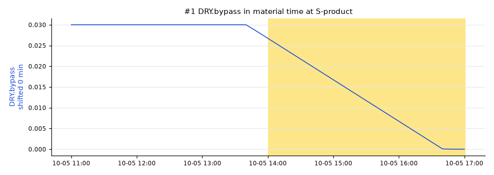

# Lot S20261005T1700: AT-201 low

AT-201 was **98 %** (spec low 99.5), sampled at SP-product on 2026-10-05 17:00 UTC.

penguineer 0.4.0, run 20261024T104235Z-a491f1.

## Summary

The leading hypothesis, with high confidence: the regime changed (DRY.bypass and the tags that moved with it).

- `DRY.bypass` (high): The regime changed from 2026-10-05 13:40 to 16:40 (DRY.bypass 0.03 to 0, H2.rate 9 to 4, TIC-201.sp 395 to 340), 0.3 h before the sample; the lot was made during it or right after it. [E002]
_Summary from the template._

## Hypotheses

| # | Cause | Kind | Score | Confidence | Summary |
|---|---|---|---|---|---|
| 1 | `DRY.bypass` | regime change | 1.00 | high | The regime changed from 2026-10-05 13:40 to 16:40 (DRY.bypass 0.03 to 0, H2.rate 9 to 4, TIC-201.sp 395 to 340), 0.3 h before the sample; the lot was made during it or right after it. |

### #1 DRY.bypass

Path: DRY.bypass, dead time 0 min.

## Ruled out

- `TT-201`: follows the loop:TIC-201 setpoint change
- `FT-102`: follows the loop:FIC-102 setpoint change
- `FT-101`: follows the loop:FIC-101 setpoint change
- `TIC-201.sp`: moved with the regime change
- `FFC-102.out`: moved with the regime change
- `FIC-101.rsp`: moved with the regime change
- `TT-301`: did not move in the lot
- `TT-200`: did not move in the lot
- `JT-001`: did not move in the lot

## How this was worked out

- Lot window: 2026-10-05 14:00 to 2026-10-05 17:01 at S-product
- Quality onset: unknown
- Regime: DRY.bypass = 0, FFC-102.ratio = 0.25, FIC-101.mode = 2, FIC-102.mode = 2, H2.rate = 4, TIC-201.mode = 1, TIC-201.sp = 340
- Reference lots: S20260927T1700 (99.7), S20260927T1400 (99.8), S20260927T1100 (99.7)
- Candidates tested: 6 tags on a 600 s grid
- Confidence: Confidence: high when the score is at least 0.4 and 0.025 ahead of the next hypothesis, medium from 0.25. Test weights: effect size 0.5, onset 0.3, lag correlation 0.3. Weights fitted on the homeostat train split (85 scenarios), thresholds chosen on the homeostat validation split (85 scenarios) (homeostat 0.1.0a3, bench plant 4144102c25e7).
- Note: some flows_to edges have no dead time; they count as 0 min
- Note: the lot spans a regime change; it counts as the regime it ended in
- Note: 62 earlier lots skipped: different regime
- Note: AT-201 started to move with lot S20260927T1700, before it left spec
- Note: the regime changed from 2026-10-05 13:40 to 16:40 (DRY.bypass 0.03 to 0, H2.rate 9 to 4, TIC-201.sp 395 to 340), 0.3 h before the sample
- Note: no online analyzer on the sampled stream: onset and correlation tests skipped
