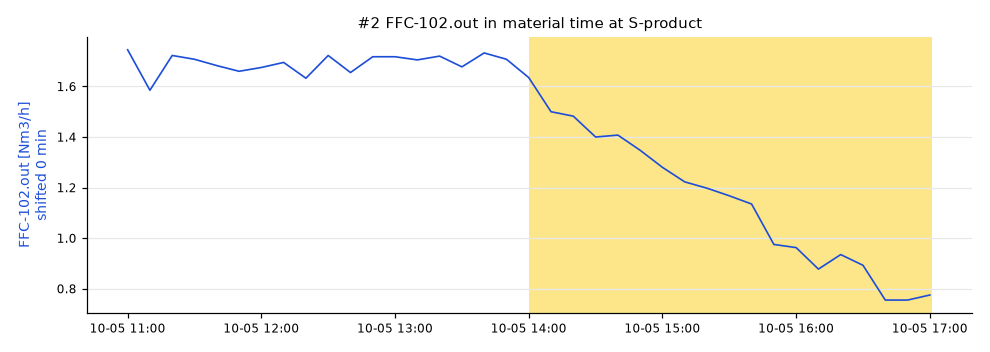
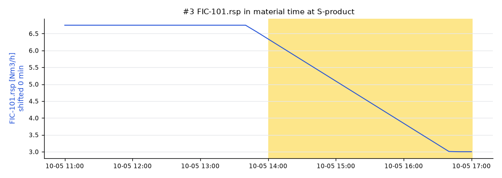

# Lot S20261005T1700: AT-201 low

AT-201 was **98 %** (spec low 99.5), sampled at SP-product on 2026-10-05 17:00 UTC.

penguineer 0.4.0, run 20261019T003810Z-66271a.

## Summary

The leading hypothesis, with high confidence: the TIC-201.sp setpoint was changed.

- `TIC-201.sp` (high): The setpoint TIC-201.sp (loop:TIC-201) was changed 21.5 degC high from 2026-10-05 14:00, 0 min upstream of the sample point. [E002]
- `FFC-102.out` (medium): The setpoint FFC-102.out (loop:FIC-102) was changed 0.923 Nm3/h high from 2026-10-05 14:00, 0 min upstream of the sample point. [E003]
- `FIC-101.rsp` (medium): The setpoint FIC-101.rsp (loop:FIC-101) was changed 3.75 Nm3/h high from 2026-10-05 14:00, 0 min upstream of the sample point. [E004]
_Summary from the template._

## Hypotheses

| # | Cause | Kind | Score | Confidence | Summary |
|---|---|---|---|---|---|
| 1 | `TIC-201.sp` | setpoint change | 1.00 | high | The setpoint TIC-201.sp (loop:TIC-201) was changed 21.5 degC high from 2026-10-05 14:00, 0 min upstream of the sample point. |
| 2 | `FFC-102.out` | setpoint change | 0.75 | medium | The setpoint FFC-102.out (loop:FIC-102) was changed 0.923 Nm3/h high from 2026-10-05 14:00, 0 min upstream of the sample point. |
| 3 | `FIC-101.rsp` | setpoint change | 0.74 | medium | The setpoint FIC-101.rsp (loop:FIC-101) was changed 3.75 Nm3/h high from 2026-10-05 14:00, 0 min upstream of the sample point. |

### #1 TIC-201.sp

Path: R-201 → V-301 → E-301 → D-401 → S-product, dead time 0 min.

- effect size: 1.00, median moved 21.5 (+63252941.2 reference scales)
- onset: not run, no quality onset
- lag correlation: not run, too little variation in the reference

### #2 FFC-102.out

Path: S-CO2 → S-feed → R-201 → V-301 → E-301 → D-401 → S-product, dead time 0 min.

- effect size: 1.00, median moved 0.923 (+7.5 reference scales)
- onset: not run, no quality onset
- lag correlation: 0.34, r = -0.34 over 12 earlier lab results

### #3 FIC-101.rsp

Path: S-H2 → S-feed → R-201 → V-301 → E-301 → D-401 → S-product, dead time 0 min.

- effect size: 1.00, median moved 3.75 (+7.4 reference scales)
- onset: not run, no quality onset
- lag correlation: 0.30, r = -0.30 over 12 earlier lab results

## Ruled out

- `TT-201`: follows the loop:TIC-201 setpoint change
- `FT-102`: follows the loop:FIC-102 setpoint change
- `FT-101`: follows the loop:FIC-101 setpoint change
- `TT-301`: did not move in the lot
- `TT-200`: did not move in the lot
- `JT-001`: did not move in the lot

## How this was worked out

- Lot window: 2026-10-05 14:00 to 2026-10-05 17:01 at S-product
- Quality onset: unknown
- Regime: DRY.bypass = 0, FFC-102.ratio = 0.25, FIC-101.mode = 2, FIC-102.mode = 2, H2.rate = 4, TIC-201.mode = 1, TIC-201.sp = 340
- Reference lots: S20260927T1700 (99.7), S20260927T1400 (99.8), S20260927T1100 (99.7)
- Candidates tested: 6 tags on a 600 s grid
- Confidence: Confidence: high when the score is at least 0.4 and 0.025 ahead of the next hypothesis, medium from 0.25. Test weights: effect size 0.5, onset 0.3, lag correlation 0.3. Weights fitted on the homeostat train split (85 scenarios), thresholds chosen on the homeostat validation split (85 scenarios) (homeostat 0.1.0a3, bench plant 4144102c25e7).
- Note: some flows_to edges have no dead time; they count as 0 min
- Note: the lot spans more than one regime; its most common one is used
- Note: 62 earlier lots skipped: different regime
- Note: AT-201 started to move with lot S20260927T1700, before it left spec
- Note: no online analyzer on the sampled stream: onset and correlation tests skipped
