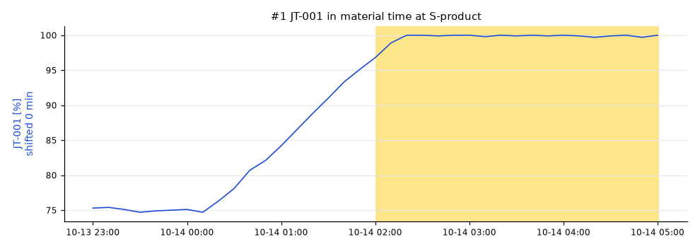
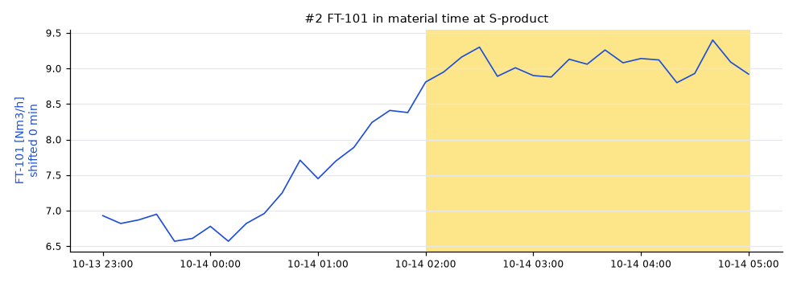
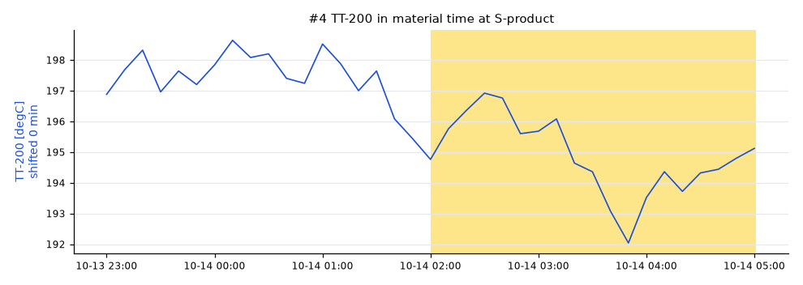

# Lot S20261014T0500: AT-201 low

AT-201 was **95.8 %** (spec low 96), sampled at SP-product on 2026-10-14 05:00 UTC.

penguineer 0.5.0, run 20261031T120232Z-a22f94.

## Summary

The leading hypothesis, with low confidence: JT-001 moved high.

- `JT-001` (low): JT-001 (EL-101) ran 24.8 % high from 2026-10-14 02:00, 0 min upstream of the sample point. [E002]
- `FT-101` (low): FT-101 (S-H2) ran 2.22 Nm3/h high from 2026-10-14 02:00, 0 min upstream of the sample point. [E003]
- `D-401` (low): no measured tag upstream moved enough to explain AT-201; something unmeasured changed in D-401 or just before the sample (a catalyst, a fouled surface, a feed component nobody analyzes)
_Summary from the template._

## Hypotheses

| # | Cause | Kind | Score | Confidence | Summary |
|---|---|---|---|---|---|
| 1 | `JT-001` | process | 0.23 | low | JT-001 (EL-101) ran 24.8 % high from 2026-10-14 02:00, 0 min upstream of the sample point. |
| 2 | `FT-101` | process | 0.23 | low | FT-101 (S-H2) ran 2.22 Nm3/h high from 2026-10-14 02:00, 0 min upstream of the sample point. |
| 3 | `D-401` | unmeasured disturbance | 0.20 | low | no measured tag upstream moved enough to explain AT-201; something unmeasured changed in D-401 or just before the sample (a catalyst, a fouled surface, a feed component nobody analyzes) |
| 4 | `TT-200` | process | 0.00 | low | TT-200 (S-feed) ran 6.86 degC low from 2026-10-14 02:00, 0 min upstream of the sample point. |

### #1 JT-001

Path: EL-101 → S-H2 → S-feed → R-201 → V-301 → E-301 → D-401 → S-product, dead time 0 min.

- effect size: 0.00, median moved 24.8 (+2.0 reference scales)
- onset: not run, no quality onset
- lag correlation: 0.61, r = -0.62 over 12 earlier lab results

### #2 FT-101

Path: S-H2 → S-feed → R-201 → V-301 → E-301 → D-401 → S-product, dead time 0 min.

- effect size: 0.01, median moved 2.22 (+2.0 reference scales)
- onset: not run, no quality onset
- lag correlation: 0.60, r = -0.60 over 12 earlier lab results

### #3 D-401

Path: D-401 → S-product, dead time 0 min.

### #4 TT-200

Path: S-feed → R-201 → V-301 → E-301 → D-401 → S-product, dead time 0 min.

- effect size: 0.01, median moved -6.86 (-2.0 reference scales)
- onset: not run, no quality onset
- lag correlation: 0.00, r = -0.67 over 12 earlier lab results, sign does not fit the deviation

## Ruled out

- `TT-301`: did not move in the lot
- `TT-201`: did not move in the lot
- `FT-102`: did not move in the lot

## How this was worked out

- Lot window: 2026-10-14 02:00 to 2026-10-14 05:01 at S-product
- Quality onset: unknown
- Regime: DRY.bypass = 0.03, FFC-102.ratio = 0.25, FIC-101.mode = 2, FIC-102.mode = 2, H2.rate = 9, TIC-201.mode = 1, TIC-201.sp = 395
- Reference lots: S20261013T2000 (97.8), S20261005T1100 (96.9), S20261005T0800 (96.3)
- Candidates tested: 6 tags on a 600 s grid
- Confidence: Confidence: high when the score is at least 0.4 and 0.025 ahead of the next hypothesis, medium from 0.25. Test weights: effect size 0.5, onset 0.3, lag correlation 0.3. Weights fitted on the homeostat train split (85 scenarios), thresholds chosen on the homeostat validation split (85 scenarios) (homeostat 0.1.0a3, bench plant 4144102c25e7).
- Note: some flows_to edges have no dead time; they count as 0 min
- Note: 66 earlier lots skipped: different regime
- Note: no online analyzer on the sampled stream: onset and correlation tests skipped
