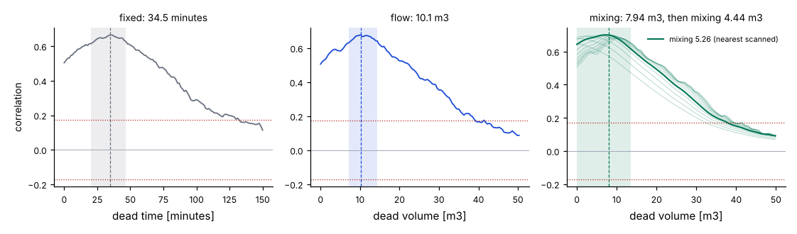
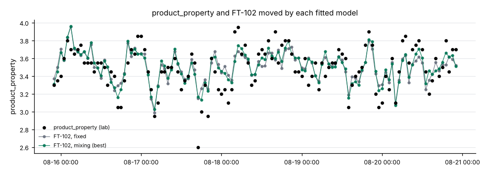

# Finding the actual lag

The dead times on the plant graph are often a guess: a volume over a design flow, or an
engineer's memory. `penguineer lag` reads the actual delay from the data, between two tags or from
a tag to a lab result, and says how the material travels: with a fixed delay, a delay that
follows the flow, or a delay with mixing.

```bash
penguineer lag --data historian.parquet --cause FT-102 \
  --effect product_property --lims lims.csv --flow FT-101 --flow FT-102 \
  --max-lag-minutes 150
```

```text
lag: FT-102 -> product_property (lab, 476 lab samples)
flow: FT-101 + FT-102, mean 20.1 m3/h

  model   dead                      mixing                delay   corr  strength
  fixed   34.54 min [20.17, 46.64]  -                 34.54 min  +0.67  3.86x chance
  flow    10.14 m3 [7.182, 14.36]   -                 30.25 min  +0.68  3.93x chance
  mixing  7.943 m3 [0, 13.52]       4.442 m3 [0, 17]  36.95 min  +0.70  4.06x chance

best: plug flow through 7.943 m3, then a mixed volume of 4.442 m3: 36.95 min on average at the mean flow
plot: runs/<run_id>/lag-profile.png
plot: runs/<run_id>/lag-fit.png
```

The run folder gets two plots: `lag-profile.png`, each model's correlation over the delay it
tries, and `lag-fit.png`, the effect with the cause moved by each fitted model.





## Three ways material travels

| Model | Parameters | The delay is | Right when |
|---|---|---|---|
| `fixed` | a dead time | constant | the throughput is steady |
| `flow` | a dead volume | the volume over the throughput, so it changes with the flow | material moves in plug flow, as in a pipe |
| `mixing` | a dead volume and a mixed volume | plug flow, then a first-order spread whose time constant is the mixed volume over the throughput | the line has a stirred vessel, or back-mixing |

The flow and mixing models count the delay in volume instead of time ("material time"): the
cumulative throughput of the `--flow` tags, summed. A change at the cause reaches the effect when
the dead volume has flowed past, however long that takes. Volumes are in the flow tag's unit times
hours (m3 for a flow in m3/h; `--flow-unit` names it). Without `--flow`, the mixing model works in
time instead: a dead time, then a time constant.

The `delay` column is each model's mean delay in minutes at the mean flow: the dead part plus the
mixing part, which is the number to compare with a dead time on the plant graph.

## How the delay is found

1. The cause and the flows are resampled to an even grid, by default the cause's median sample
   period.
2. Each model tries every delay up to `--max-lag-minutes` (240), and the mixing model a range of
   mixed volumes for each: the cause is spread by the mixing, shifted by the dead part, and
   read at the effect's times.
3. The prediction is compared with the effect by correlation:
    - An online effect is compared on the grid after prewhitening both with one AR model of the
      cause, as in [`graph lags`](dead-times.md), so that slow drifts do not pass for a link. A
      peak counts when |corr|·√n reaches `--z-threshold` (5).
    - A lab effect is compared at its sample times. The chance level comes from running the same
      search on the cause rotated by a random offset, 59 times per model: rotation cuts the link
      but keeps the cause's own slow swings. A peak counts when it beats every rotated search of
      every model (the `strength` column is the ratio).
4. A coarse scan finds the peak, and a finer one around it gives the estimate. The interval is
   the run of values whose |corr| is within two standard errors of the peak's.
5. The result names the fixed or the flow model, whichever correlates more, unless the mixing
   model's extra parameter explains significantly more of the effect (an F test on r², p ≈ 0.01).

## Checked on Homeostat plants

`scripts/validate_lag.py` runs the [bench plant](bench.md) with no fault and no grade change,
its feed flows swinging ±10% within the hour, and the reactor's back-mixing drawn per plant, so the
true volumes are known. It fits feed B's flow (FT-102) against the lab's product property, with
the total flow FT-101 + FT-102: the change crosses the mixer's outlet pipe and the reactor in plug
flow, then the reactor's back-mixing spreads it.

With a lab result every hour over 20 days (about 480 results), on six plants:

| Plant | True dead | True mixed | True delay | Fitted dead | Fitted mixed | Fitted delay | Fixed model | Chosen |
|---|---|---|---|---|---|---|---|---|
| 0 | 8.46 m3 | 5.80 m3 | 43.3 min | 8.22 m3 | 4.97 m3 | 40.1 min | 29.1 min | fixed |
| 1 | 5.92 m3 | 2.52 m3 | 25.3 min | 5.96 m3 | 1.74 m3 | 23.1 min | 23.4 min | mixing |
| 2 | 8.26 m3 | 4.51 m3 | 38.1 min | 7.94 m3 | 4.44 m3 | 37.0 min | 34.5 min | mixing |
| 3 | 7.03 m3 | 2.01 m3 | 27.5 min | 7.53 m3 | 1.44 m3 | 27.3 min | 28.5 min | flow |
| 4 | 5.66 m3 | 2.62 m3 | 25.1 min | 5.66 m3 | 2.96 m3 | 26.1 min | 25.6 min | mixing |
| 5 | 6.60 m3 | 2.11 m3 | 25.8 min | 6.99 m3 | 2.47 m3 | 28.0 min | 25.8 min | mixing |

The mixing model finds the dead volume within 0.25 m3 on average and the mixed volume within
0.5 m3, and the mean delay within 1.7 minutes; the fixed model's delay is off by 3.5 minutes on
average, and by 14 minutes on plant 0, the plant with the most mixing, where the noisier data
leave the choice at the fixed model. The intervals are wide (the dead volume's often starts at 0),
because a dead volume and a mixed volume trade off against each other when the data are sparse.
The example at the top of this page is plant 2.

With the usual lab rhythm, a result every 4 hours, 60 days give about 360 results. The mixing
model is chosen on five of the six plants, and its mean delay is off by 2.1 minutes on average
(dead volume 0.9 m3, mixed volume 1.1 m3); the fixed model's by 4.3 minutes. Three days of
4-hourly results (18 of them) are too few: under 20 results the command stops with exit code 3.
A lag from lab data needs weeks.

The script also fits FT-102 against the online analyzer AT-101 on the mixer's outlet. There the
analyzer's own reporting delay and sample hold (about 11 minutes, at any flow) blur the
transport, and the models agree within about 2 minutes of the true mean delay.

```bash
uv sync --extra bench
uv run python scripts/validate_lag.py --plants 6 --days 20 --lab-hours 1
uv run python scripts/validate_lag.py --plants 6 --days 60 --lab-hours 4
```

## Limits

- A lag can only be read where the cause moves. A tag held still by a controller, or a feed that
  never changes, carries no delay to find, and the result says no model is above chance.
- Lab results are sparse: weeks of them are needed, and the chance level is honest about it.
  Grade changes and other large steps dominate a correlation of levels, so pick a window of
  steady operation with `--start` and `--end`.
- The models are for transport. A link through a controller, a recycle or a heat balance has a
  delay too, but it is not a volume, and the mixing model may fit it with a misleading one.
- Several causes moving together share their delays: the fit finds the delay of whatever moves
  the effect, which need not be the tag named.
